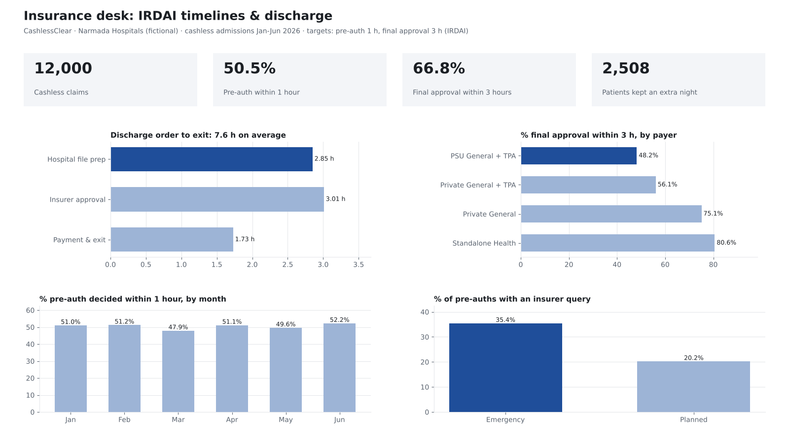
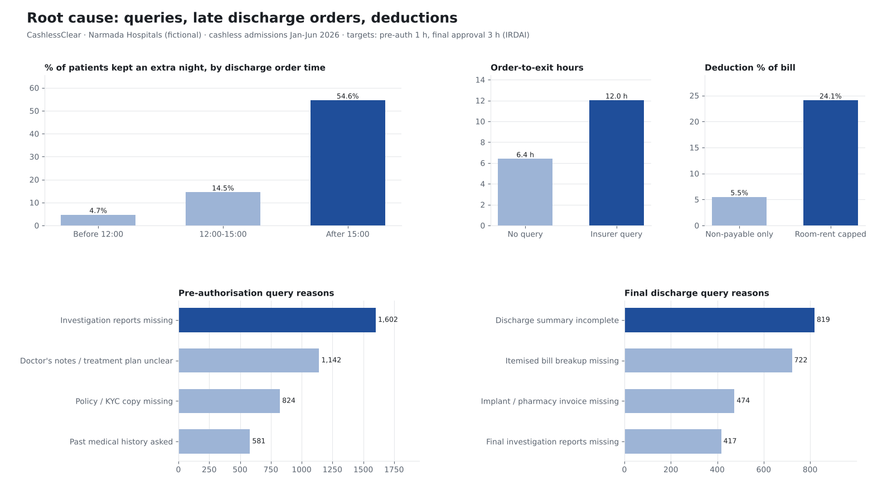

# 04_powerbi

Two-page dashboard design for the hospital COO and insurance desk manager.

| Page | Question it answers | Visuals |
| --- | --- | --- |
| 1. Insurance desk overview | Are we meeting the 1-hour / 3-hour timelines, and where does discharge time go? | 4 KPI cards (claims, pre-auth within 1 h, final within 3 h, extra nights), discharge time split, % within 3 h by payer / TPA, pre-auth 1 h % by month, pre-auth query % by admission type; slicers for hospital, department, payer type |
| 2. Root cause | Why is it slow, and what does it cost patients? | Extra night % by order time, exit hours with / without a query, deduction % with / without room-rent capping, query reasons at both stages |

- [`DAX_measures.md`](DAX_measures.md): load steps, Power Query columns, relationship, measures, expected values
- [`screenshots/`](screenshots): preview of both pages

> The previews are drawn from the same data and match the Excel and SQL results. The `.pbix` file will be added to this folder once it is built in Power BI Desktop using the steps above.
