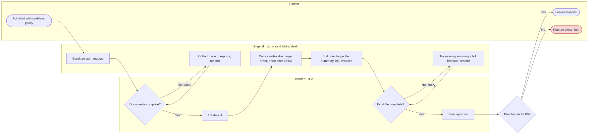
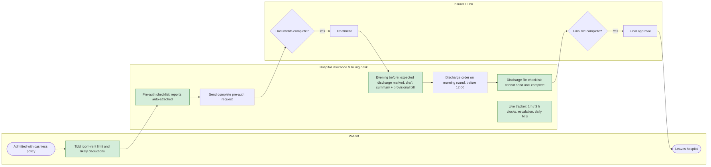

# 3. Process flows (AS-IS and TO-BE)

Swimlane flows drawn in Mermaid (sources: [`as_is.mmd`](as_is.mmd), [`to_be.mmd`](to_be.mmd)).

## AS-IS

Pain points (from the data):
1. **Incomplete pre-auth requests:** 35.4% of emergency and 20.2% of planned pre-auths get an insurer query; the top reason is missing investigation reports. The hospital takes about 5 hours to answer a pre-auth query.
2. **Discharge file built only after the order:** the hospital needs 2.85 hours on average to send the file, 37.6% of the whole discharge wait.
3. **Late discharge orders:** 3,011 orders were written after 15:00, and 54.6% of those patients stayed an extra night.
4. **Incomplete discharge files:** 21.0% of final files get a query (incomplete summary, missing bill breakup); a query almost doubles the wait (6.4 h → 12.0 h).
5. **Surprise deductions:** retail-policy patients in single rooms lose 24.1% of the bill to room-rent capping, often learnt only at discharge.

## TO-BE

What changes (green boxes):
1. Room-rent limit and likely deductions are explained **at admission**.
2. A **pre-auth checklist** by department pulls investigation reports from the hospital system automatically.
3. **Discharge planning:** expected discharges are marked on the evening round; the draft summary and provisional bill are prepared that night; discharge orders are written on the morning round.
4. A **discharge file checklist** blocks sending until the summary, itemised bill, implant / pharmacy invoices and final reports are attached.
5. A **live tracker** shows each claim's 1-hour / 3-hour clock, escalates delays to the insurer or TPA, and feeds a daily MIS.
