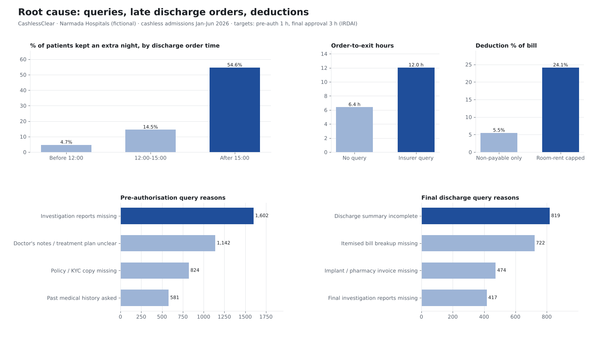

# CashlessClear: Cashless Claim & Discharge Delay · Healthcare BA Case Study

> Business Analysis case study on **synthetic data**. Narmada Hospitals and all insurers are fictional.

## Business problem

Insured patients in India often wait hours after the doctor says "you can go home", because the hospital and the insurer must finish the cashless claim first. IRDAI's Master Circular on Health Insurance (May 2024) asks insurers to decide cashless requests **within 1 hour** and give final discharge approval **within 3 hours**. As a Business Analyst at a 3-hospital group, the goal was to measure performance against these timelines, find **where the delay really sits**, and define requirement-backed fixes the hospital itself controls.

## Key findings (12,000 cashless admissions, Jan-Jun 2026)

1. Only **50.5%** of pre-authorisations were decided within 1 hour, and **66.8%** of final approvals came within 3 hours.
2. Patients waited **7.6 hours** from discharge order to exit. The **hospital's own file preparation took 2.85 hours (37.6%)**, almost as long as the insurer's approval (3.01 hours).
3. Most queries ask for documents the hospital already has: **missing investigation reports** (1,602 of 4,149 pre-auth queries), **incomplete discharge summaries** and **missing bill breakups**. A discharge query nearly doubles the wait (**6.4 h → 12.0 h**).
4. **2,508** patients were kept an **extra night**. When the discharge order is written after 15:00, **54.6%** stay another night, against **4.7%** for orders before noon.
5. Claims handled by **PSU insurers through a TPA** meet the 3-hour timeline only **48.2%** of the time (standalone health insurers: **80.6%**).
6. Retail-policy patients in single rooms lose **24.1%** of the bill to room-rent capping (others: 5.5%), usually learnt only at discharge.

## Proposed solution

| Priority | Solution |
| --- | --- |
| Must | Pre-auth checklist with auto-attached reports · discharge file checklist that blocks incomplete files · discharge planning the evening before · live 1 h / 3 h claim tracker with escalation and daily MIS |
| Should | Room-rent check and deduction estimate at admission · monthly payer / TPA scorecard |
| Could | Connect to NHCX (National Health Claims Exchange) |

**Expected impact** (discharge planning + discharge checklist only): about **604 bed-nights freed** per 6 months (room for about **140 more admissions**, about **Rs 1.5 crore** billing) and about **1,216 fewer discharge queries** ([estimate and assumptions](05_ba_docs/10_ROI_estimate.md)).

## What's in this repo

| Folder | Contents |
| --- | --- |
| [`01_data`](01_data) | Raw data (with deliberate quality issues), cleaned claims, insurer queries, data dictionary |
| [`02_excel`](02_excel) | Excel workbook: cleaning log, lookup table, formula columns, KPIs and analysis tables |
| [`03_sql`](03_sql) | PostgreSQL schema, load script, 12 business queries and their results |
| [`04_powerbi`](04_powerbi) | 2-page dashboard design, Power Query columns, DAX measures and page previews |
| [`05_ba_docs`](05_ba_docs) | Problem statement, RACI, AS-IS / TO-BE flows, 5 Whys, fishbone, gap analysis, MoSCoW, **BRD**, user stories, RTM, UAT cases, impact estimate |
| [`scripts`](scripts) | Data generator, impact estimate, dashboard preview |
| [`BUILD_GUIDE.md`](BUILD_GUIDE.md) | Step-by-step build of the Excel, SQL and Power BI parts |

## Approach

1. **Discover:** problem statement, SMART goals, stakeholders and RACI
2. **Clean:** removed 180 duplicates, fixed 500 payer values, mapped 300 short department names with VLOOKUP in Excel
3. **Analyse:** IRDAI timeline compliance, discharge time split, queries, extra nights and deductions in Excel and SQL; results match
4. **Visualise:** 2-page dashboard (desk overview, root cause)
5. **Define:** AS-IS / TO-BE flows, 5 Whys, fishbone, gap analysis, MoSCoW
6. **Document:** BRD, 10 user stories with acceptance criteria, RTM, 13 UAT test cases
7. **Measure:** impact estimate and success KPIs

## Tools

Excel · PostgreSQL · Power BI (Power Query, DAX) · Mermaid (process flows)

## Reference

IRDAI Master Circular on Health Insurance Business, 29 May 2024 (cashless decision within 1 hour, final discharge approval within 3 hours).

## Author

Salil Gokhale · [LinkedIn](https://www.linkedin.com/in/salil-gokhale-analytics) · [GitHub](https://github.com/Salil360-cyber)
